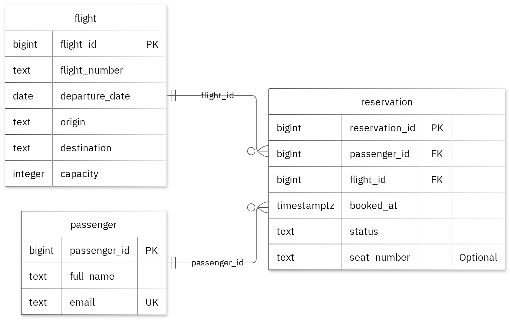

# MIT 8103 Advanced Database Systems

**Airline Reservation System** · Ndukeobong Eton · Student ID 301926659

## Case study

My case study is Airline Reservation System. I designed the database for passengers viewing and reservations, airline staff managing bookings and reviewing flight bookings, with separate tables named flight, passenger and reservation. It supports these operations: create a reservation for a passenger on a flight; confirm or cancel a reservation; review confirmed reservations by flight and date.

## Portfolio 1: Database Design and Modelling

The goal is to represent three things: flights, passengers, and reservations. The design keeps each kind of information in its own table, then connects them with IDs.
-	flight stores one scheduled flight: its number, departure date, route, and seat capacity.
- passenger stores a passenger’s name and email.
-	reservation records a passenger’s booking for a flight, including when it was booked and its status
The relational design is organised into 3 tables. Primary keys identify records, foreign keys preserve the links, and enforce the stated business rules. 
-	flight capacity must be greater than 0
-	flight number and departure date identifies one flight
-	passenger email must be unique
	reservation status: (pending, confirmed, cancelled)
-	a confirmed seat on a flight cannot be used twice

The normalisation examples show the sample data at 1NF, 2NF and 3NF. All 11 deliberately invalid inserts were rejected without changing the valid sample rows.

Figure 1. Tables, keys and relationships. PK: primary key; FK: foreign key; UK: unique value.

<!-- PAGE BREAK -->

## Portfolio 2: Query Processing and Optimisation

I ran three SQL queries against the sample records. The join returned 2 rows and included Avery Stone with SW101. For the index comparison, I used 20,000 separate performance rows. The median lookup time changed from 1.145 ms (non-indexed) to 0.172 ms (indexed). Both phases returned the same records. The measured plan used the new index. These temporal data applies to this lookup and environment.

## Portfolio 3: Transactions and Concurrency

I used a temporary counter on reservation to test COMMIT, ROLLBACK and READ COMMITTED isolation. The uncommitted update remained hidden from the other session, and ROLLBACK restored the earlier committed value. Without locking, two increments left the counter at 2. With SELECT FOR UPDATE, Session B waited for Session A and the final value was 3. The helper is confined to this exercise; the case's original business fields stay unchanged.

## Portfolio 4: NoSQL and Advanced Data Models

I used reservation_events for the case's event documents. MongoDB inserted 4 sample events and returned the expected results for 4 queries. Validation rejected an invalid date type and a duplicate event ID. Embedded snapshots keep related details with an event, while the details field can differ by event type. These are fictional events; PostgreSQL continues to enforce its relational rules.

## Repository and evidence

https://github.com/neton6659-afk/Eton_Ndukeobong_301926659

The portfolio folders contain the SQL and JavaScript, explanations, query plans, result tables and screenshots.

<!-- PAGE BREAK -->

## Portfolio 5: Distributed and Cloud Database Exercise

I proposed three MongoDB replica members across separate failure zones. The discussion covers primary elections, majority acknowledgement, secondary lag and sharding trade-offs for reservation_events. Replication supports availability, while backups address recovery. PostgreSQL needs its own availability plan. This is the permitted discussion option; no live replica set or failover test was deployed.

## Individual reflection

I kept flight, passenger, reservation in separate tables so their details could be maintained without repeating them in every related record. Among reservations with status confirmed and a non-null seat_number, each flight_id and seat_number pair is unique. The constraint tests check this alongside the required values and record links. One issue illustrated by the two-session exercise is that both sessions can read the same value before either update is committed. Locking the row before reading preserves both increments. The index comparison also shows why I need to check the execution plan as well as the final answer: the same result can require different amounts of database work.
On a personal note, this repo is teaching a complete database story:
1.	Design the schema correctly -Design and modelling
2.	Build valid relationships and constraints
3.	Query the data - Query processing
4.	Optimise query speed - Optimisation
5.	Handle multiple users at once - concurrency
6.	Support event-driven data in MongoDB
7.	Think about distributed systems and fault tolerance - distributed and cloud DB
So the project is not just “SQL queries”. It is a full learning journey through database systems, which is very enlightening.
## AI-use declaration

I used GitHub Copilot and the portfolio generator to help prepare the database model, scripts and explanations. The generator ran the PostgreSQL and MongoDB exercises, checked their outputs and captured the result images.  I remain responsible for checking and explaining the submitted work.

## References

- [PostgreSQL: constraints](https://www.postgresql.org/docs/17/ddl-constraints.html)
- [PostgreSQL: EXPLAIN](https://www.postgresql.org/docs/17/using-explain.html)
- [PostgreSQL: isolation](https://www.postgresql.org/docs/17/transaction-iso.html)
- [PostgreSQL: row locks](https://www.postgresql.org/docs/17/explicit-locking.html)
- [MongoDB: data modelling](https://www.mongodb.com/docs/manual/data-modeling/)
- [MongoDB: replication](https://www.mongodb.com/docs/manual/replication/)
- [MongoDB: sharding](https://www.mongodb.com/docs/manual/sharding/)
- [Mermaid: ER diagrams](https://mermaid.js.org/syntax/entityRelationshipDiagram.html)
- [W3schools: SQL](https://www.w3schools.com/sql/default.asp)

